# Paint-by-Numbers Generator

This repository turns a source image into a printable, painter-friendly paint-by-numbers workbook. It does not stop at posterizing an image. It builds a full guide: clustered color map, real-paint recipes, transfer sketch, staged painting pages, per-color pages, before/after progress previews, recipe diagnostics, and optional centerline SVGs for plotting.

The first thing the generator gives you is the thing you actually care about: the finished workbook view, with the simplified painting and the paint recipes beside it.

<p align="center">
  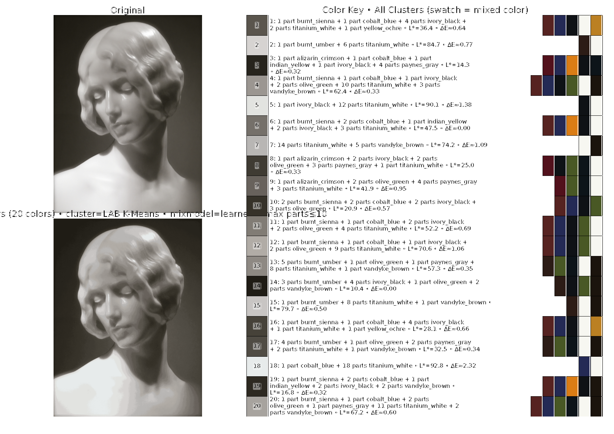
</p>

The current sample guide is included here:

[paint_by_numbers_guide_1.pdf](paint_by_numbers_guide_1.pdf)

---

## What This Is

The project answers a practical painting question:

> Given an image, how do I turn it into a sequence of paintable decisions?

The PDF is designed to help a painter know:

1. What the final simplified painting should look like.
2. Which physical pigments to mix for each color.
3. Where each color goes.
4. What has already been painted.
5. What the canvas should look like after the current color.
6. How to transfer the drawing and grid.

That is why the output is a workbook rather than a single image.

---

## The Current Output

The generator creates an A4 landscape PDF. A current run has this broad structure:

- Page 1: overview, source, clustered painting, and full color key.
- Page 2: transfer sketch with grid.
- Pages 3-8: broad painting stages.
- Pages 9-28: one page per color.
- Final page: completed paint map.
- Extra files: centerline SVGs for plotting/editing.

### Overview And Color Key

The overview page is the main reference page. It shows the source image, the simplified paint map, and every recipe.

<p align="center">
  
</p>

This is the page to keep nearby when you want the whole painting in your head.

### Source And Sketch

The current default source image and supplied sketch are:

<p align="center">
  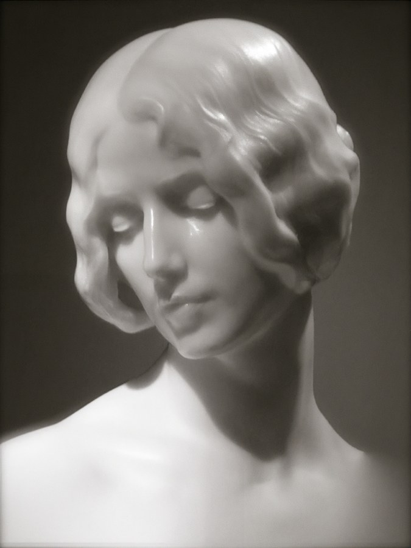
  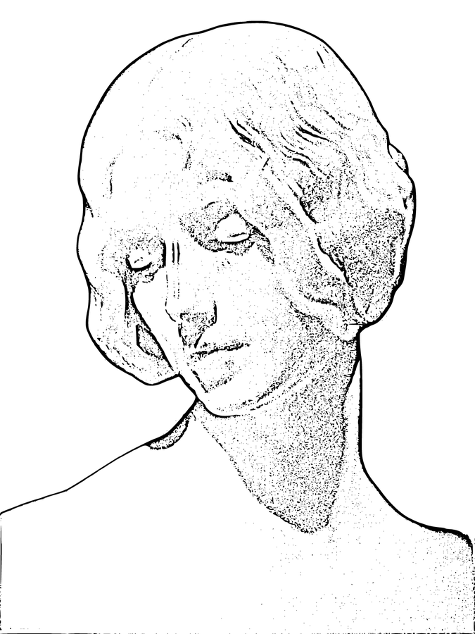
</p>

The sketch is not the main output; it is part of the process. It is used for transfer, for linework under the painting frames, and for centerline SVG tracing.

### Transfer Sketch

The transfer sketch page gives you a gridded drawing that can be copied onto canvas or paper.

<p align="center">
  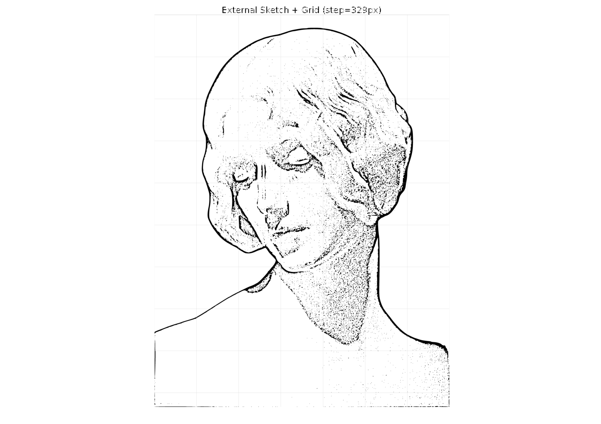
</p>

If `external_sketch` is set in [pbn/config.py](pbn/config.py), the generator uses that exact sketch instead of generating linework from image edges.

### Broad Painting Stages

Before the one-color pages, the guide gives broader painting stages. These are useful because painters often work by value and structure before chasing every small color region.

<p align="center">
  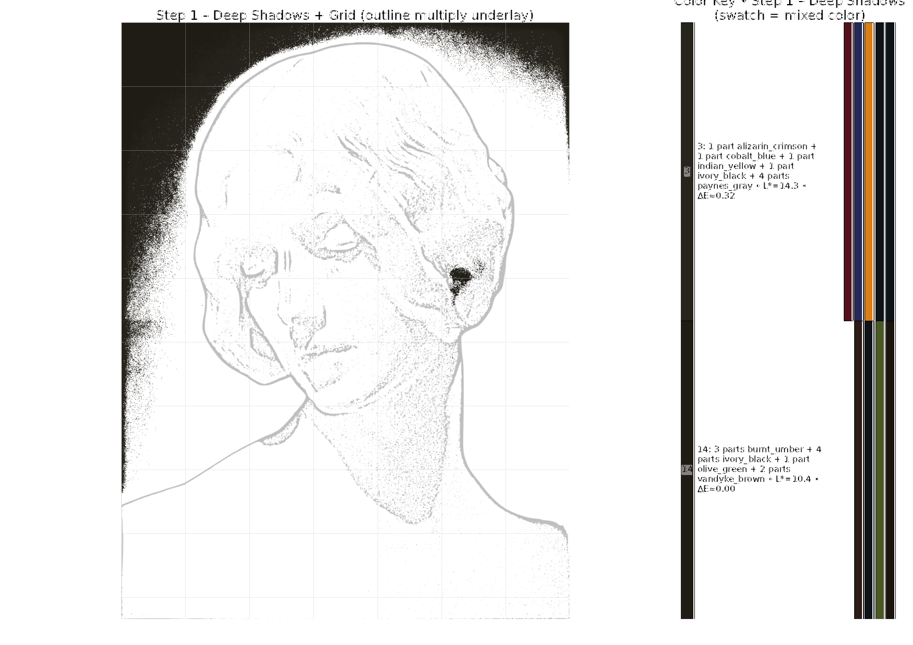
  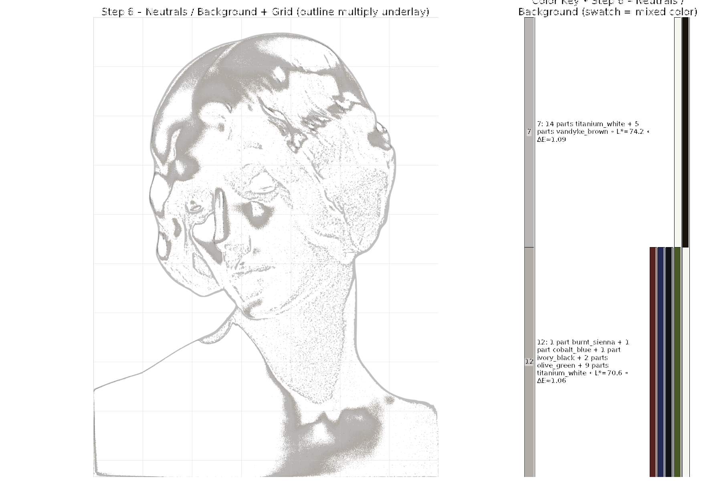
  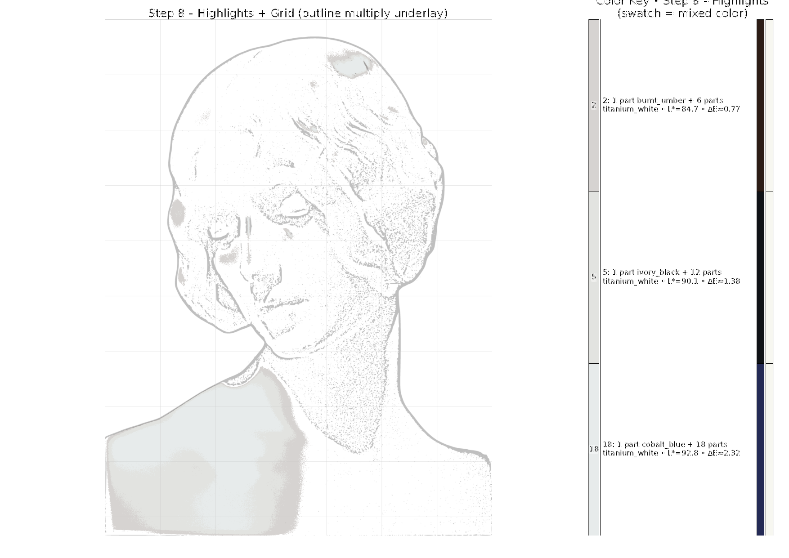
</p>

The default stage mode is:

```python
frame_mode = "combined"
```

That means the generator combines value-based staging with practical color grouping. The intent is a reasonable painting order: establish dark structure, build midtones and background, then add lighter regions.

### Per-Color Pages

Each per-color page is a working instruction sheet for one color.

<p align="center">
  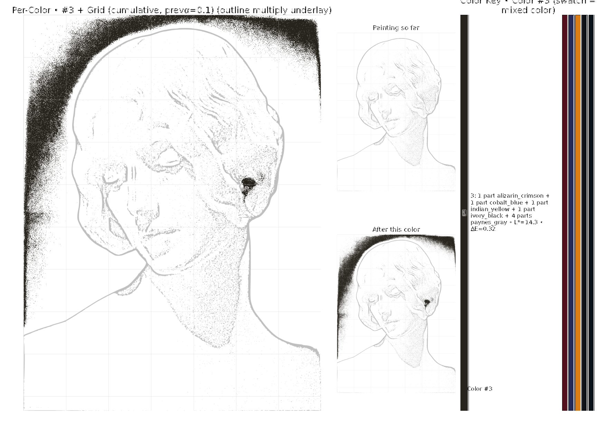
</p>

The current code layout is:

- Column 1: large working frame for the current color.
- Column 2 top: `Painting so far`.
- Column 2 bottom: `After this color`.
- Column 3 top: completed painting reference.
- Column 3 bottom: recipe, mixed swatch, and pigment components.

The middle column exists because it is easy to lose orientation on a long paint-by-number sequence. You can see the canvas before this color and after this color without mentally reconstructing the whole process.

<p align="center">
  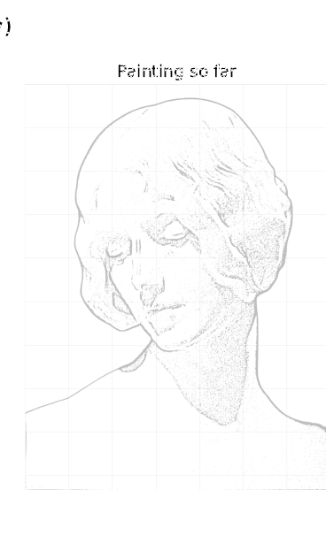
  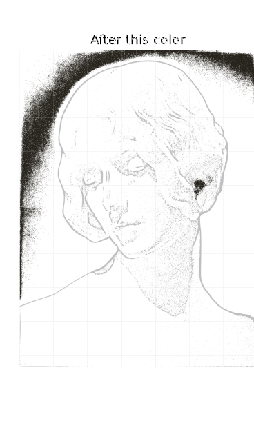
  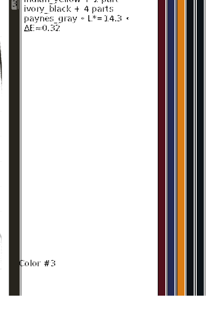
</p>

Later pages show the same idea after more colors have accumulated:

<p align="center">
  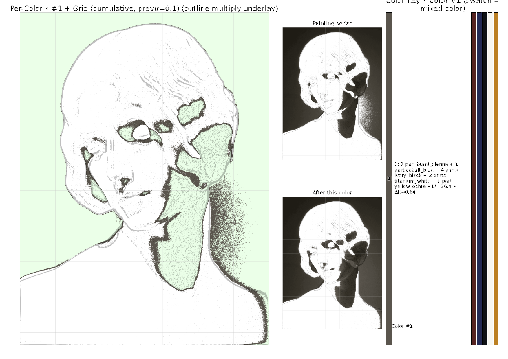
  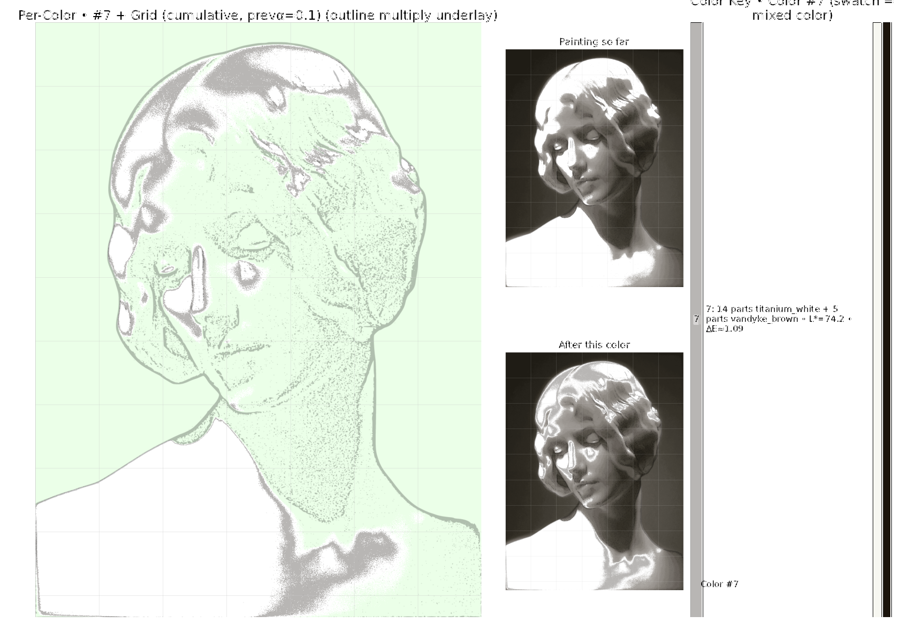
</p>

### Completed Map

The final PDF page shows the completed simplified painting with the grid.

<p align="center">
  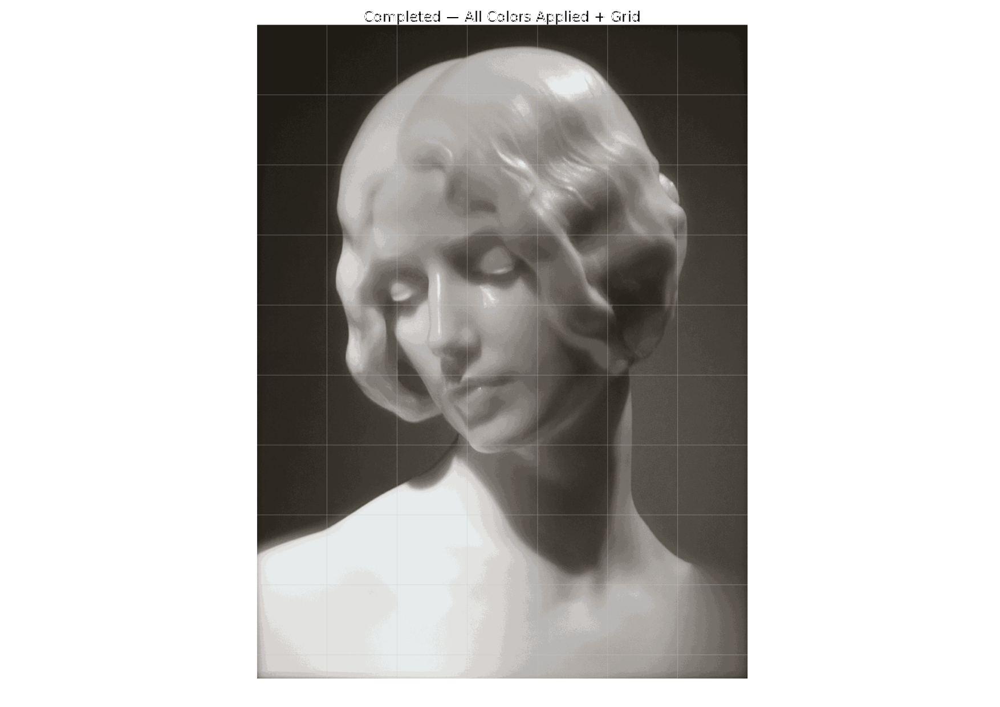
</p>

---

## Pipeline

The generator is a chain of image-processing, color-matching, and layout steps.

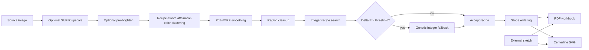

---

## Color Clustering

By default, the image is clustered using colours from the valid integer-recipe
catalogue:

```python
colors = 20
resize = None
clustering_method = "recipe_aware"
```

`colors = 20` means the image is reduced to 20 attainable paint mixtures.
`resize = None` means clustering uses the full-resolution image rather than a
smaller proxy. The earlier unconstrained mode remains available with
`clustering_method = "lab_kmeans"`.

Recipe candidates and image colours are compared with CIEDE2000 in CIELAB.
This prevents the generator from first inventing an arbitrary cluster colour
that the permitted whole-number recipes cannot reproduce.

Recipe-aware clustering minimizes CIEDE2000 so image quantization preserves
overall perceptual color. Final recipe selection adds a painter-oriented value
guardrail: among recipes with `|Delta L*| <= 2.0`, it chooses the lowest
CIEDE2000 Delta E. `|Delta L*| <= 1.0` is the preferred reported value match.
If no permitted integer recipe meets the guardrail, the closest attainable
value is used and the miss is reported.

After clustering, the label map is upsampled to full image size and can be smoothed.

---

## Region Smoothing

Raw K-Means often creates speckles: tiny isolated islands of color. The generator can run a Potts/MRF-style smoothing pass:

```python
mrf_smoothing = True
mrf_beta = 7.0
mrf_iterations = 4
```

The smoothing step balances two goals:

- Keep pixels close to their clustered color.
- Encourage neighboring pixels to share labels.

This makes the result more paintable without simply blurring the image.

There is also optional region cleanup:

```python
min_region_px = 0
min_region_pct = 0.0
```

Those can be increased when you want tiny connected components merged into neighboring regions.

---

## Paint Mixing Model

The generator does not use arbitrary color names. It searches recipes from a real pigment palette:

```python
BASE_PALETTE = {
    "alizarin_crimson": ...,
    "burnt_sienna": ...,
    "burnt_umber": ...,
    "cobalt_blue": ...,
    "indian_yellow": ...,
    "ivory_black": ...,
    "olive_green": ...,
    "paynes_gray": ...,
    "titanium_white": ...,
    "vandyke_brown": ...,
    "yellow_ochre": ...,
}
```

Each candidate recipe is mixed with the Mixbox model. Mixbox is used because physical pigment mixing is nonlinear. Simple RGB averaging is not good enough for paint.

The default first-pass search is still deterministic and exhaustive:

```python
components = 5
max_parts = 10
max_part_per_pigment = 5
```

The generator builds a reusable catalogue containing every valid recipe with:

- no more than 10 total parts,
- no more than 5 pigments,
- no more than 5 parts of any pigment, and
- only reduced ratios (`2:4` is stored as `1:2`).

Every target color is compared with the complete catalogue. The result is the
lowest overall perceptual color difference that also satisfies the configured
absolute L* guardrail. There is no random search and repeated runs return the
same recipe.

Example recipe:

```text
1 part burnt_sienna + 2 parts cobalt_blue + 5 parts titanium_white + 1 part yellow_ochre
```

The result is scored with Delta E.

---

## Delta E

Delta E is the color difference between:

- the target cluster color, and
- the predicted mixed-paint color.

With the default recipe-aware clustering, the target is the mean Lab color of
the original-image pixels finally assigned to that numbered region after
smoothing and cleanup. It is intentionally kept separate from the attainable
recipe color; comparing the recipe color with itself would always report a
misleading zero.

The PDF translates both errors into clearly defined percentages while retaining
raw Delta E. `Err=143% tol (Delta E=4.30)` means the error uses 143% of
the configured acceptable Delta E tolerance of `3.0`; it does not mean the color
is 143% different. Zero percent is a perfect match, 50% uses half the tolerance,
and values up to 100% are inside the reporting tolerance. `Delta L=-1.97% darker`
means Delta L* is -1.97 percentage points on the complete 0-100 L* scale.
Positive is lighter and negative is darker. This is deliberately not a
percentage relative to the target L*, which becomes unstable near black.

The current default method is:

```python
delta_e_method = "colour_ciede2000"
```

### Automatic palette reduction

`colors` is a maximum, not a required final count. After clustering, smoothing,
region cleanup, and integer-recipe resolution, the generator automatically
merges predicted paint mixtures that are perceptually redundant. The defaults
require every color in a merged group to remain within both:

```python
palette_merge_delta_e = 1.5  # CIEDE2000 complete-link threshold
palette_merge_delta_l = 1.0  # maximum absolute L* separation
```

The combined source pixels receive a newly optimized integer recipe. The merge
is accepted only if that recipe remains within both limits of every original
predicted mixture. This complete-link validation prevents a chain of individually
similar colors from joining when the colors at the ends are visibly different.
It works identically for grayscale and full-color images. Set `palette_merge =
False` to require the old fixed count, or adjust the thresholds when a simpler
or more conservative palette is preferred.

Lower is better. In practical terms:

- `Delta E <= 1.0` (up to 33% tolerance): excellent digital match.
- `Delta E <= 2.0` (up to 67% tolerance): close match.
- `Delta E <= 3.0` (up to 100% tolerance): acceptable reporting range.
- `Delta E > 3.0` (above 100% tolerance): noticeable difference worth reviewing.

Important caveat: Delta E here measures the software model. It does not guarantee your physical tube paints will match perfectly. The model predicts from RGB pigment constants and Mixbox. Real paint tubes can behave differently, especially in tints with strong pigments.

---

## Exact Integer Recipe Catalogue

The catalogue is generated once per run and reused for all target colors.
Equivalent scaled recipes are discarded using their greatest common divisor.
Candidate colors are batch-converted to CIELAB and scored with CIEDE2000, which
keeps exhaustive matching fast even when the catalogue contains tens of
thousands of valid recipes.

---

## Recipe Cache

The generator now writes a recipe target cache:

```python
write_recipe_cache = True
recipe_cache = "outputs/recipe_targets.json"
```

The cache stores:

- color number,
- target RGB,
- chosen recipe,
- predicted mixed RGB,
- Delta E,
- signed Delta L*, and
- guardrail status and optimizer settings.

---

## Progress Reporting

Long runs now print coarse stage markers and progress bars.

Example:

```text
[1/6] Loading image and preparing inputs...
[2/6] Clustering image colors...
[3/6] Smoothing and cleaning color regions...
[4/6] Building paint recipes for 20 colors...
Recipes:  35%|███████             | 7/20
[5/6] Planning painting stages...
[6/6] Rendering PDF pages...
Stage pages: ...
Per-color pages: ...
```

The exhaustive recipe catalogue is built once and reused for every color.

---

## PDF Page Logic

### Overview Page

The overview page includes:

- original image,
- simplified paint-by-numbers map,
- complete color key,
- mixed swatches,
- component pigment chips,
- Delta E values.

### Stage Pages

Stage pages group multiple colors by painting logic:

- deep shadows,
- core shadows,
- midtones,
- neutrals/background,
- half-lights,
- highlights.

### Per-Color Pages

Per-color pages are more precise. They show:

- where this exact color goes,
- what has already been painted,
- what the painting should look like after this color,
- a completed reference,
- the recipe and swatches.

By default, per-color pages use an adjacent painting order. The generator
builds a neighbor graph from the final color-label map, then grows the sequence
from already-painted regions. It first prefers a color touching the previous
page's color; when that path is exhausted, it chooses a color touching any
painted area. This keeps the workbook closer to a continuous painting workflow
instead of jumping between value groups or isolated in-between regions.

Relevant config:

```python
per_color_frames = True
per_color_order_mode = "adjacent"
per_color_cumulative = True
prev_alpha = 0.10
prev_highlight_mode = "neon_green"
```

---

## Centerline SVG Output

The generator also writes:

- [centerline_output.svg](centerline_output.svg)
- [centerline_output_canvas.svg](centerline_output_canvas.svg)

These are useful if you want vector linework for plotting, editing, or transfer workflows.

Current canvas settings:

```python
canvas_dimensions_mm = (240, 300)
canvas_long_margin_mm = 5.0
grid_step = "auto"
grid_min_cols = 7
```

If `vpype` is available, the generator can use it. If not, it still writes the raw SVG.

---

## Running The Generator

From the repository root:

```powershell
.\venv\Scripts\python.exe paint_by_numbers_generic_v8_pdf.py
```

The entry point is intentionally small:

```python
from pbn.generator import main

if __name__ == "__main__":
    main()
```

Most behavior is controlled in:

[pbn/config.py](pbn/config.py)

Default output:

```python
pdf = "paint_by_numbers_guide.pdf"
```

The included sample PDF is:

```text
paint_by_numbers_guide_1.pdf
```

---

## Common Configuration Changes

### Use Another Image

```python
input = "pics/my_image.jpg"
```

### Use Your Own Sketch

```python
external_sketch = "pics/my_sketch.png"
```

Use dark lines on a light background. The sketch will be resized to the source image size.

### Change Number Of Colors

Simpler:

```python
colors = 12
```

More detailed:

```python
colors = 30
```

More colors can preserve detail, but they also produce more recipes, more pages, and more decisions.

### Change First-Pass Recipe Complexity

Simpler first-pass recipes:

```python
components = 3
max_parts = 6
```

More expressive first-pass recipes:

```python
components = 5
max_parts = 10
```

### Adjust Sketch Strength

```python
sketch_alpha = 0.25
```

Lower values make the sketch lighter. Higher values make it stronger.

### Split Foreground And Background

```python
separate_fg_bg = True
```

When enabled, the generator can create background color pages first, then foreground color pages seeded with the completed background.

---

## Practical Caveat About Real Paint

The recipes are model-based. They are better than RGB averaging, but they are still predictions.

Real paint can differ because:

- your tube color may not match the stored palette constant,
- blue pigments can tint strongly when mixed with white,
- titanium white can reveal chroma in a mixture,
- pigment brands vary,
- wet paint and dry paint can differ,
- lighting changes perception.

The generator gives a strong starting point. For important colors, especially pale neutrals containing cobalt/blue, test a small swatch before committing a large area.

---

## Repository Layout

```text
pbn/
  generator.py       Main pipeline and PDF assembly
  config.py          Default configuration
  mixing.py          Mixbox and exhaustive constrained integer search
  image_ops.py       Sketch, grid, cleanup, smoothing helpers
  pdf_render.py      Color key and PDF layout helpers
  svg_trace.py       Centerline SVG tracing

scripts/
  cluster_preview.py                 Generate a quick clustering preview

pics/
  100.PNG             Current sample source image
  100_sketch.png      Current sample external sketch

docs/readme/
  *.png              README images rendered from the generated PDF

outputs/
  recipe_targets.json                Recipe target cache after generation

paint_by_numbers_guide.pdf
  Generated guide (ignored by Git)
```

---

## Current Sample Run

A representative run prints:

```text
SUPIR upscale check: longest=3072px >= 3000px -> no upscale.
Pre-brighten skipped (pre_brighten_pct=0).
Applying Potts/MRF label smoothing (beta=7.0, iterations=4).
Recipe target cache saved: outputs/recipe_targets.json
Saved A4 landscape PDF to paint_by_numbers_guide.pdf
Centerline SVG with grid saved: centerline_output.svg
Centerline canvas SVG saved: centerline_output_canvas.svg
```

On this machine, full generation has typically taken a few minutes depending on image size and PDF page count.

